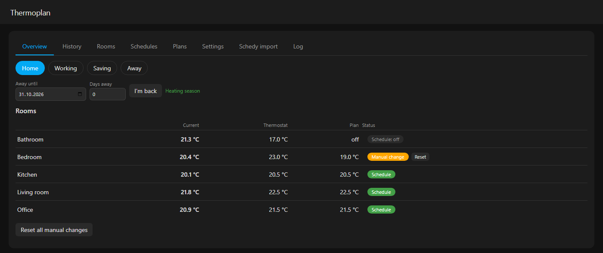
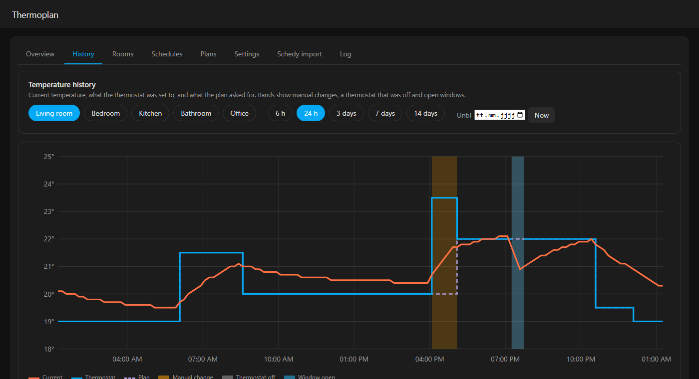
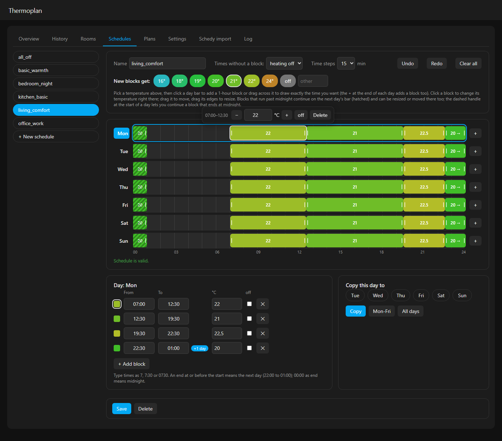
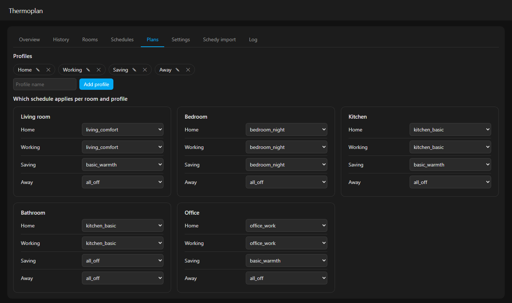
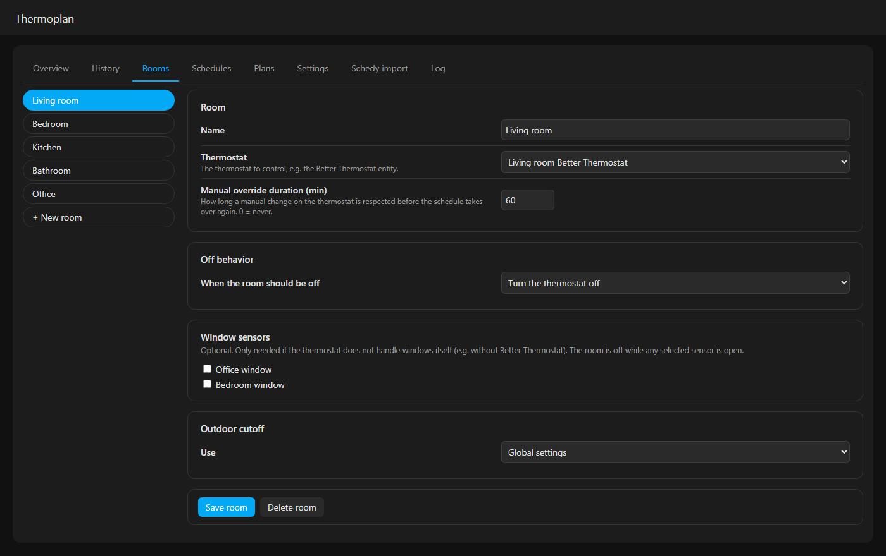
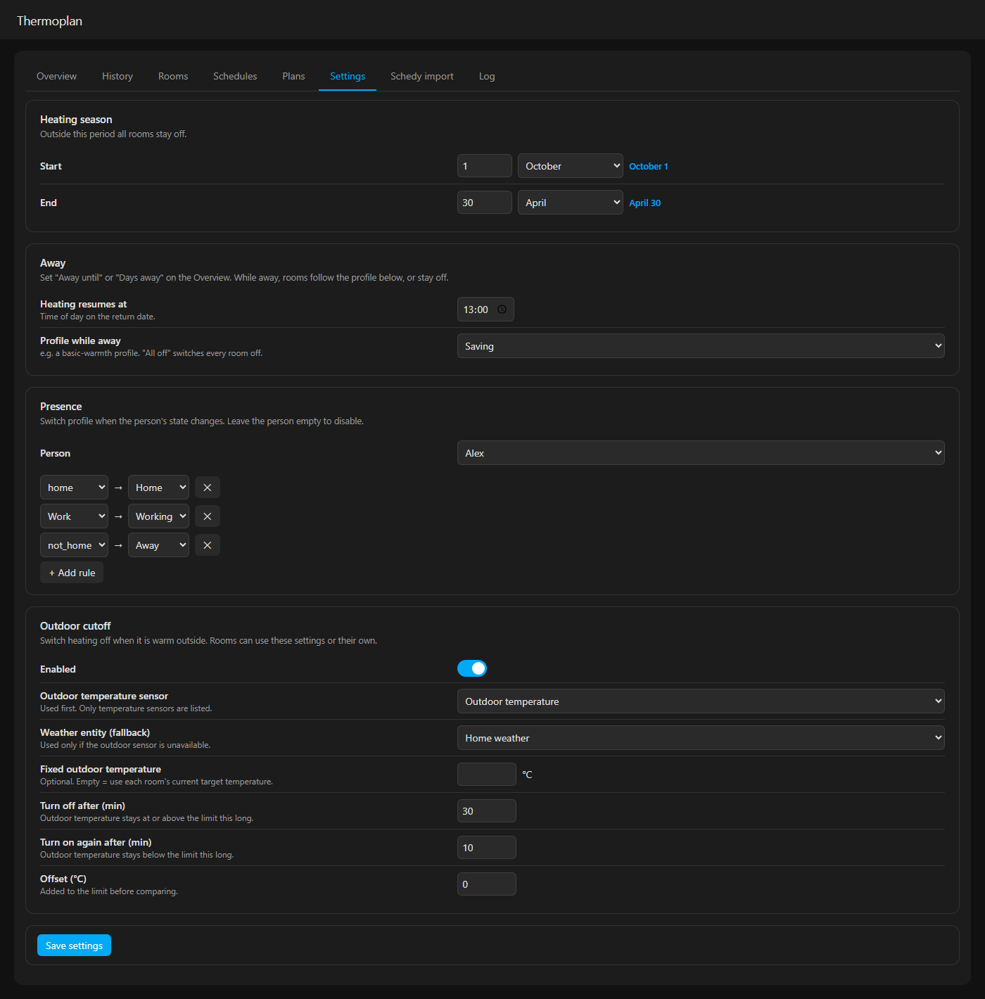
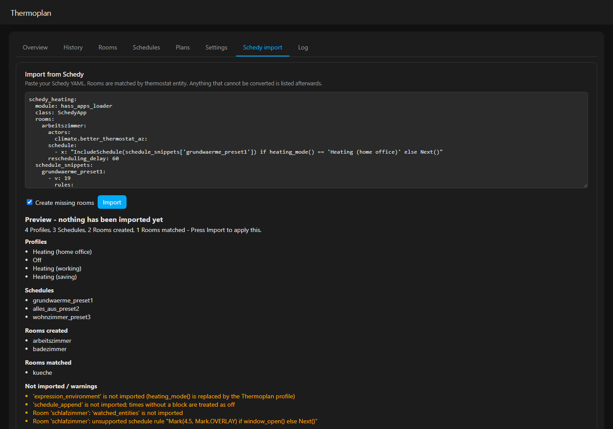
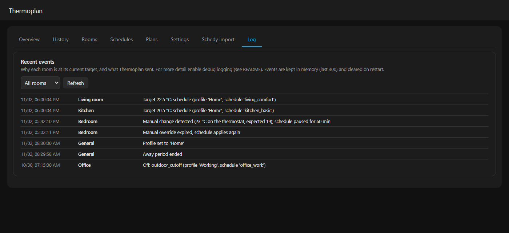

# HA-Thermoplan

Home Assistant integration for schedule-based thermostat control with global heating profiles.
It replaces AppDaemon + Schedy and the helper/automation glue around it (profile select, heating period, away counter).

Requires Home Assistant 2026.10 or newer. English and German.

## Screenshots

**Overview**: switch profile, set away, see current / thermostat / plan temperature and status per room, reset manual changes.



**History**: per room, pick a range or a day; current temperature, thermostat setting and plan on one chart, with bands for manual changes, a thermostat that was off and open windows. Hover for exact values.



**Schedules**: draw, move and resize blocks on a week grid; click a block to change its temperature on the spot. Blocks crossing midnight continue on the next day.



**Plans**: choose which schedule applies per room and profile.



<details>
<summary>More: Rooms, Settings, Schedy import, Log</summary>






</details>

The panel is available in English and German (`docs/screenshots/*-de.png`). Screenshots use demo data and are generated with `tools/screenshots/make_screenshots.py`.

## Concept

- **Profiles** are global modes (e.g. "Home office", "Away", "Saving"). One profile is active at a time.
- **Schedules** are reusable, named weekly plans: time blocks with a target temperature (or off) per weekday. Blocks may cross midnight.
- Each **room** (one thermostat) maps every profile to a schedule.
- Thermoplan sits on top of [Better Thermostat](https://github.com/KartoffelToby/better_thermostat): it only sets targets or turns the thermostat off. Window sensors and the external temperature sensor stay with Better Thermostat. Without Better Thermostat you can add window sensors per room.

## Features

- Sidebar panel with a graphical week-grid schedule editor, rooms, profile plans, settings, import and a log; overview card for dashboards (`Thermoplan` in the card picker)
- Heating season (start/end date); outside it all rooms are off
- Away until a date (or a number of days) with a configurable resume time (e.g. back on the 4th, heating resumes at 13:00), optional profile while away (e.g. basic warmth); set 0 when you are back early
- Presence rules: when a person entity changes to `home`, `not_home` or a zone name, switch profile
- Outdoor cutoff: heating off when the outdoor temperature has stayed at or above the room's current target for X minutes, on again after Y minutes below. Global or per room; outdoor sensor with weather entity as fallback
- Per-room manual-override timeout (0 = off), per-room "off" behavior (turn the thermostat off, or set a fixed temperature such as 4.5), optional window sensors
- Each room has a target sensor whose `reason` attribute tells why it is in its current state
- Schedy importer

## Installation

1. HACS > Custom repositories > add `https://github.com/KrX3D/HA-Thermoplan` as *Integration*, install, restart Home Assistant.
2. Settings > Devices & services > Add integration > Thermoplan. The integration page only links to the sidebar; everything is configured there.
3. Open **Thermoplan** in the sidebar.

## Setup (sidebar)

- **Rooms**: add each thermostat (the Better Thermostat climate entity), its off behavior, override duration, optional window sensors and outdoor-cutoff scope.
- **Schedules**: pick a temperature, then click or drag on a day bar to add a block; click a block to change its temperature; drag to move or resize. An end at or before the start continues on the next day (e.g. 22:00 to 01:00).
- **Plans**: add profiles, then choose which schedule applies per room and profile.
- **Settings**: heating season, away resume time and profile, person and presence rules, global outdoor cutoff.
- **Overview**: switch profile, set *Away until* (date) or *Days away*, see each room's target.

### Migrating from Schedy

The *Schedy import* tab: paste your Schedy YAML. A preview appears right away and shows what would be imported (and what cannot be); press *Import* to apply it. Profiles are taken from the `heating_mode() == '...'` expressions, schedules from `schedule_snippets`, and `rescheduling_delay` becomes the room's override duration. Rooms are matched by thermostat entity or created. Anything that could not be converted (extra expressions, `watched_entities`, `schedule_prepend`, ...) is listed in the report.

Afterwards you can remove the `input_select.heizungsmodus` card, the heating-period helpers and the `Heizperiode` automation.

## Troubleshooting

- **Log tab** in the sidebar: why each room is at its current target (profile, schedule, reason), manual changes, overrides, away and season changes, and failed commands. The last 300 events are kept in memory.
- **Home Assistant log:** the same events are written at INFO level; the exact commands sent to thermostats are written at DEBUG level. To enable them:

```yaml
logger:
  logs:
    custom_components.thermoplan: debug
```

- Example lines: `Target 26 °C (was 27 °C): schedule (profile 'Home', schedule 'bedroom', block 00:00-07:00)`, `Sent climate.set_temperature {'temperature': 26.0} (thermostat was heat, target 27.0)`, `Manual change detected (21.5 °C on the thermostat, expected 22.0); schedule paused for 60 min`, `Profile set to 'Away' (presence rule: person.alex is now 'not_home'); manual overrides cleared`.
- Each room's target sensor has the attributes `reason`, `schedule_target`, `climate_entity` and `override_until`.

### Windows and Better Thermostat

If Better Thermostat switches a thermostat off because a window is open, Thermoplan leaves it alone: it only switches a thermostat back on if it switched it off itself (or after you press *Reset*, or change the profile). When Better Thermostat turns the thermostat on again, Thermoplan makes sure it is at the planned temperature. You do not need to add window sensors in Thermoplan when Better Thermostat handles them.

## Entities

| Entity | Purpose |
|---|---|
| `select` Profile | Active profile |
| `binary_sensor` Heating season | On inside the heating season |
| `date` Away until | Day you are back; heating resumes that day at the configured time |
| `number` Away days | Days away; 0 = home |
| `binary_sensor` Away | On while away; use it to trigger your own automations (lights, MQTT, vacuum, notifications) |
| `sensor` Target (per room) | Current target, attributes `reason`, `schedule_target`, `override_until` |

## Development

- `prototypes/schedule-editor.html` is a standalone version of the schedule editor (no Home Assistant needed). Open it in a browser to try or change the editing behavior (drawing, moving and resizing blocks, midnight-crossing blocks, undo/redo) before porting changes into `custom_components/thermoplan/frontend/`.
- Engine tests run anywhere: `pip install pytest pyyaml && pytest`. Tests that need Home Assistant run in CI.

## License

MIT
